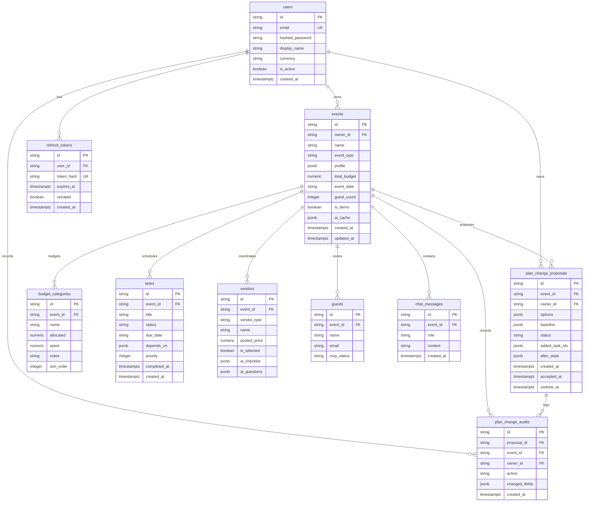

# EventCraft AI

**A celebration and event planner for turning a big idea into a plan you can act on.**

EventCraft helps individuals and community organizers plan weddings, birthdays, and other gatherings. It brings event details, budgets, tasks, vendors, guests, and planning ideas together in one web app.

> **Important:** Budgets, vendor details, availability, and AI-generated suggestions are planning aids, not confirmed quotes or commitments. Verify them with the relevant people before making decisions.

## Contents

- [What you can do](#what-you-can-do)
- [How Plan Health works](#how-plan-health-works)
- [Technology](#technology)
- [Run locally](#run-locally)
- [Test and inspect](#test-and-inspect)
- [Configuration](#configuration)
- [PostgreSQL and Neon](#postgresql-and-neon)
- [Database schema](#database-schema)
- [Security and data](#security-and-data)
- [Production-readiness status](#production-readiness-status)
- [Deployment preparation](#deployment-preparation)
- [Known limitations](#known-limitations)

## What you can do

- Create events through a guided flow, with validated occasion, date, location, budget, guest target, and preferences.
- View event summaries, budget progress, upcoming work, vendors, and guest information on the dashboard.
- Edit event information and planning preferences directly from the relevant Overview cards.
- Organize a budget by category, review AI suggestions, and compare proposed budget scenarios before applying them.
- Plan and track tasks, dependencies, due dates, and completion.
- Keep vendor details, quotes, and interview questions together; treat unverified prices and availability as estimates.
- Manage guests and RSVPs, search and paginate the list, and import a size-limited UTF-8 CSV.
- Ask event-contextual questions and generate structured themes, decor, menu, and activity ideas.
- Explore a demo event without first creating an account.
- Use **Plan Health & Crisis Mode** to identify explainable risks and compare proposed responses.

The active event view checks for updates every 15 seconds while the page is visible and idle, and when you return to the tab. It does not redraw unchanged content, pauses during editing/modal activity or unsaved form changes, and warns before leaving the page with unsaved form data.

## How Plan Health works

Plan Health calculates an explainable score from the event plan. Checks include budget pressure or overruns, overdue or blocked tasks, dependency cycles, missing vendor quotes, time pressure, past event dates, and venue capacity below the guest target. The score is available as both text and a visual ring.

For a disruption, the app presents options for review; it does not silently change the event. The host chooses whether to accept or decline an option. Accepted changes record the actor, timestamp, action, and changed field names. The original crisis description is not stored in that audit record. Undo is allowed only while the event still matches the accepted state, so it will not overwrite a newer edit.

Known disruption types are handled with deterministic rules. For unfamiliar wording, the server may ask Gemini to classify the short description into a strict intent schema. Event records such as guest names and vendor notes are not sent for that classification. If AI is unavailable or the result fails validation, the app proposes a deterministic review checklist instead. Calculations and plan changes remain in application code.

**Demo walkthrough**

1. Select **Try the demo** on the sign-in screen.
2. Open **Plan Health & Crisis** from the navigation or dashboard.
3. Enter a disruption such as “Guests increased from 150 to 220,” or choose an example.
4. Compare the options and review any estimate labels.
5. Accept an option to apply it, or decline it to leave the plan unchanged. If accepted, try **Undo accepted changes** before making another edit.

The seeded demo is Priya & Arjun’s wedding. Its budget and guest count are example data; the event date is set relative to when the demo data is seeded.

## Technology

- **Backend:** Python 3.11, FastAPI, SQLAlchemy 2, Pydantic 2.
- **Database:** SQLite for local development; PostgreSQL on Neon for durable deployments.
- **Frontend:** Vanilla JavaScript modules and CSS, served by the FastAPI application. There is no frontend build step.
- **AI:** Gemini is called from the backend through `httpx`; API keys are not sent to the browser. Temporary primary-model service errors trigger a fallback request to `gemini-3.5-flash-lite`.
- **Deployment target documented here:** Docker container on Google Cloud Run with Neon PostgreSQL and Secret Manager.

Database schema changes are managed with Alembic migrations. The application does not alter the schema when it starts; apply migrations before starting a new or upgraded environment.

## Run locally

The commands below use PowerShell and assume you opened this project’s root folder.

1. Create and activate a Python 3.11 virtual environment:

   ```powershell
   py -3.11 -m venv .venv
   .\.venv\Scripts\Activate.ps1
   ```

2. Install backend dependencies and create your local environment file:

   ```powershell
   python -m pip install -r backend\requirements.txt
   Copy-Item .env.example .env
   ```

3. Edit `.env`. Replace `APP_SECRET_KEY` with a fresh random value of at least 32 characters. Generate one locally with:

   ```powershell
   python -c "import secrets; print(secrets.token_urlsafe(48))"
   ```

   Gemini is optional for local use. Without a Gemini key, the app continues to provide deterministic planning and fallback behavior.

4. Initialize a new local database by applying the schema migrations:

   ```powershell
   Set-Location backend
   python -m alembic upgrade head
   ```

   If you already have a local database created by an earlier EventCraft version, first make and verify a backup. Do not run the initial migration against an initialized database. After verifying that its schema matches the initial revision, record that baseline and apply the new database revision:

   ```powershell
   python -m alembic stamp 0f5a78aeb321
   python -m alembic upgrade head
   ```

   These commands change the existing database schema in place; they do not delete its rows. Do not stamp or migrate a database if its schema differs from the baseline.

5. From the project root, start the application with the short Windows command:

   ```powershell
   .\run.bat
   ```

6. Open <http://127.0.0.1:8000>. In development, interactive API documentation is available at <http://127.0.0.1:8000/api/docs>.

The default local database file is `backend\eventplanner.db`. Keep it private; it may contain event and account data.

## Test and inspect

Run the backend tests against a fresh in-memory SQLite database from the backend directory. Remove any database overrides first so tests cannot target your local data:

```powershell
Remove-Item Env:DATABASE_URL -ErrorAction SilentlyContinue
Remove-Item Env:DATABASE_URL_DIRECT -ErrorAction SilentlyContinue
Remove-Item Env:TEST_DATABASE_URL -ErrorAction SilentlyContinue
Set-Location backend
python -m pytest -q
```

To run the same suite against PostgreSQL, set `TEST_DATABASE_URL` to a dedicated disposable database (for example, a separate Neon test branch) and run `python -m pytest -q`. Tests create and drop application tables and the PostgreSQL migration test recreates the schema. **Never point `TEST_DATABASE_URL` at a database containing data you need.**

Check frontend JavaScript syntax from the project root:

```powershell
Get-ChildItem frontend\src -Recurse -Filter *.js | ForEach-Object { node --check $_.FullName }
```

The test suite covers authentication and ownership, validation, error handling, rate limits, security headers, CSV handling, budget and task APIs, and Plan Health proposal workflows. Frontend syntax checking is not a substitute for browser testing.

The latest local verification recorded for this revision is **127 backend tests passed** and **19 JavaScript modules syntax-checked**. The test run emitted one Starlette/httpx deprecation warning. These results do not certify a production deployment.

## Configuration

Configuration is read from environment variables and, for local development, from the project-root `.env` file. See [.env.example](./.env.example) for the template. Do not put actual secret values in source control, issue reports, screenshots, or shared logs.

| Variable | Purpose | Local default / production guidance |
|---|---|---|
| `APP_ENV` | Selects `development`, `test`, or `production` behavior. | `development`; set to `production` for a live service. |
| `APP_SECRET_KEY` | Signs authentication tokens. | Required; use a fresh random secret at least 32 characters long. |
| `DATABASE_URL` | SQLAlchemy database connection. | Local SQLite by default; production must use durable PostgreSQL. |
| `DATABASE_URL_DIRECT` | Direct PostgreSQL URL for Alembic. | Optional; migrations fall back to `DATABASE_URL`. Prefer Neon's direct, non-pooled URL. |
| `DB_POOL_SIZE` | Maximum persistent PostgreSQL connections per instance. | `3`; keep the total across all Cloud Run instances under the database limit. |
| `DB_MAX_OVERFLOW` | Temporary connections above the pool size. | `0` by default to keep Neon connection use predictable. |
| `DB_POOL_RECYCLE_SECONDS` | Recycle idle connections. | `300`, suitable for databases that suspend idle compute. |
| `DB_POOL_TIMEOUT_SECONDS` | Maximum wait for a pool connection. | `10`. |
| `DB_CONNECT_TIMEOUT_SECONDS` | Driver connection timeout. | `5` seconds. |
| `DB_CONNECT_RETRIES` | Attempts for a new database connection. | `3` with a short exponential backoff. |
| `DB_RETRY_BACKOFF_SECONDS` | Base delay between connection retries. | `0.5` seconds. |
| `POSTGRES_DB`, `POSTGRES_USER`, `POSTGRES_PASSWORD` | Optional local Docker PostgreSQL settings. | Local-only values; keep real values in the ignored `.env`. |
| `ALLOWED_ORIGINS` | Comma-separated CORS origins. | Localhost origins by default; configure only the origins actually used. |
| `CURRENCY` | Currency shown by the planner. | `INR` by default. |
| `GEMINI_API_KEY` | Enables live Gemini features. | Optional locally; store in a secret manager in production. |
| `GEMINI_MODEL` | Gemini model identifier. | `gemini-3.8-flash`; retired `gemini-2.0-flash` values are automatically upgraded. |
| `GEMINI_TIMEOUT_SECONDS` | Timeout for Gemini requests. | `30`. |
| `GEMINI_MAX_RETRIES` | Retry limit for Gemini requests. | `3`. |
| `GEMINI_RETRY_BACKOFF_BASE` | Base delay for retry backoff. | `1.5` seconds. |
| `AI_CACHE_TTL_SECONDS` | Lifetime of an in-process Gemini response cache entry. | `3600` seconds. |
| `AI_CACHE_MAX_ENTRIES` | Maximum Gemini response entries retained in process memory. | `256`; least-recently-used entries are evicted first. |
| `RATE_*` | Authentication, user, AI, and backoff rate-limit settings. | See `backend\app\config\settings.py`; `RATE_MAX_TRACKED_KEYS` defaults to `50000`. |
| `UPLOAD_MAX_BYTES` | Maximum CSV upload size. | `2097152` bytes (2 MiB). |
| `UPLOAD_MAX_ROWS` | Maximum imported CSV data rows. | `500`. |
| `UPLOAD_DIR` | Upload storage location, outside the static web root. | `uploads`. CSV import is handled in memory. |
| `BODY_MAX_BYTES` | Maximum request body size enforced by middleware. | `1048576` bytes (1 MiB). |
| `LOG_LEVEL` | Application logging level. | `INFO`. |

Production settings reject SQLite because a container's local filesystem is not durable.

## PostgreSQL and Neon

SQLite remains the default for local development. Neon PostgreSQL is the recommended persistent database for Cloud Run. `DATABASE_URL` selects the runtime database; on Neon, use the **pooled** connection URL and keep `sslmode=require`. `DATABASE_URL_DIRECT` is optional and should contain Neon's **direct, non-pooled** URL for Alembic and data-copy operations. Both values are environment variables; never commit them or paste them into chat.

1. Create a Neon project and a separate test branch/database. Copy the pooled URL for runtime and the direct URL for migrations. Ensure each Neon URL includes `sslmode=require`.
2. Store these values locally in the ignored project-root `.env`, or set them in the process environment. Do not replace the local SQLite default unless you intend to run against PostgreSQL.
3. Run migrations from `backend` using the direct URL:

   ```powershell
   $env:DATABASE_URL_DIRECT = '<your direct Neon URL, including sslmode=require>'
   python -m alembic upgrade head
   ```

   Applying this command creates or updates the tables in the selected database. Confirm the target URL is correct and make a backup before applying it to any database with existing data. Migrations are a controlled release step; the web app does not run them during startup.
4. Start locally against Neon by setting the pooled URL as `DATABASE_URL` and running `.\run.bat` from the project root. To return to local SQLite, remove that override or set `DATABASE_URL=sqlite:///./eventplanner.db`.

An optional local PostgreSQL service is defined in [docker-compose.yml](./docker-compose.yml). Copy `.env.example` to `.env`, replace the local-only password placeholder, and run:

```powershell
docker compose up -d postgres
Set-Location backend
$pgPassword = [uri]::EscapeDataString($env:POSTGRES_PASSWORD)
$env:DATABASE_URL = "postgresql://$($env:POSTGRES_USER):$pgPassword@127.0.0.1:5432/$($env:POSTGRES_DB)"
python -m alembic upgrade head
```

Local PostgreSQL does not require TLS. The Neon SSL requirement applies to Neon hosts only.

### PostgreSQL tests

The regular suite defaults to isolated SQLite. For PostgreSQL, use a disposable database or Neon test branch, set both `TEST_DATABASE_URL` and `DATABASE_URL_DIRECT` to its direct psycopg-compatible connection URL, then run:

```powershell
$env:TEST_DATABASE_URL = '<your disposable PostgreSQL test URL>'
$env:DATABASE_URL_DIRECT = $env:TEST_DATABASE_URL
Set-Location backend
python -m pytest -q
```

The test configuration normalizes `postgresql://` to psycopg 3, uses a small pool, and routes the app and Alembic tests only to `TEST_DATABASE_URL`. The PostgreSQL migration test drops and recreates application tables; it must never target production. Without a disposable PostgreSQL URL, those integration tests are skipped and PostgreSQL behavior remains unverified.

### Viewing and querying data

- SQLite: open `backend\eventplanner.db` with DB Browser for SQLite.
- Neon: use the Neon SQL Editor, or connect with DBeaver/pgAdmin using the pooled URL and SSL.
- Recruiter-friendly, read-only PostgreSQL examples are in [docs/sample_queries.sql](./docs/sample_queries.sql).

### Existing SQLite data and rollback

The existing local SQLite database contains user-created data, so it must not be treated as disposable demo data. The verified backup is `backend\backups\eventplanner-20261026T140513Z.sqlite3`; its ten application-table row counts matched the source, SQLite integrity checks passed, and no foreign-key violations were reported. The local database and backup remain in place. On 2026-10-26, the configured Neon database was migrated to Alembic head `51d2a6f89c43`, then the existing SQLite application data was copied after explicit approval. The transfer utility reported matching counts for all ten application tables; a read-only follow-up check confirmed that source and Neon counts still match. No database URLs or credentials are recorded here.

The copy utility is `backend\scripts\copy_sqlite_to_postgres.py`. It opens the source SQLite database read-only, requires the target hostname to be explicitly confirmed, requires an Alembic-head PostgreSQL schema, refuses any non-empty application table, copies in dependency order in one PostgreSQL transaction, preserves IDs, normalizes naive SQLite timestamps to UTC, and compares row counts before committing. It does not delete or change source rows. For any future transfer, verify the exact destination and obtain explicit approval first; the existing Neon target is non-empty and the utility will refuse to copy into it again.

For a **new, empty target only**, after its schema has been initialized and its hostname reviewed and explicitly approved, use the following example from `backend`. Do not run it against the already populated Neon target. Enter URLs locally; never paste them into chat or replace these placeholders with actual secrets in the README:

```powershell
$env:SOURCE_DATABASE_URL = 'sqlite:///eventplanner.db'
$secureTarget = Read-Host 'Enter the direct Neon target URL (hidden)' -AsSecureString
$targetPointer = [Runtime.InteropServices.Marshal]::SecureStringToBSTR($secureTarget)
try {
    $env:TARGET_DATABASE_URL = [Runtime.InteropServices.Marshal]::PtrToStringBSTR($targetPointer)
    python -m scripts.copy_sqlite_to_postgres --confirm-target '<exact-Neon-hostname>'
}
finally {
    [Runtime.InteropServices.Marshal]::ZeroFreeBSTR($targetPointer)
    Remove-Item Env:SOURCE_DATABASE_URL -ErrorAction SilentlyContinue
    Remove-Item Env:TARGET_DATABASE_URL -ErrorAction SilentlyContinue
}
```

Before this command can work, first upgrade the local SQLite database using the verified backup and initialize the empty Neon database to the current migration head. Both steps modify a database schema; migrating Neon and copying its data require separate explicit approval. After the transfer, inspect the printed per-table counts and verify login and event ownership before pointing the live service at it.

Switching `DATABASE_URL` back to SQLite only changes which database the application uses; it does not copy PostgreSQL writes back to SQLite. Cloud Run's local filesystem is ephemeral and must not be used as a production rollback database. For a production rollback, preserve a Neon restore point/branch before a migration, restore into a separate database or branch if recovery is needed, validate it, then update the Cloud Run `DATABASE_URL` secret and deploy a known-good application revision. Do not run a schema downgrade or point the live service at a restored database until compatibility and data have been checked.

Common connection problems:

| Message or symptom | Check |
|---|---|
| SSL required / SSL off | Keep `sslmode=require` in both Neon URLs. |
| Too many connections | Keep runtime pool size small, overflow at zero, and Cloud Run max instances bounded. |
| Password authentication failed | Re-copy the correct Neon URL; URL-encode reserved characters in passwords. Never paste the real value into a terminal command or commit it. |
| First connection times out after idle | The service retries a new connection briefly; verify the Neon endpoint is active and allow enough request startup time. |

## Database schema

Amounts use `NUMERIC(14,2)` on PostgreSQL, structured columns use `JSONB`, timestamps use timezone-aware storage, and booleans remain native booleans. SQLite keeps its native JSON/NUMERIC-compatible types for local development. UUID-like text IDs are retained to preserve existing API IDs; they are application-generated, so these tables do not use auto-incrementing sequences. Foreign keys are indexed and owned event rows cascade on deletion. Emails have a unique index on `lower(email)` to prevent case-only duplicates. Events use an optimistic version column so concurrent edits fail instead of silently overwriting newer changes.



## Security and data

- Authentication uses HttpOnly cookies; production cookies are marked Secure and SameSite=Lax.
- Account creation uses generic responses. Signup passwords must be 8-128 characters and include an uppercase letter and a number; the requirement is shown beside the password field. Login, signup, and token refresh are rate-limited for at most five minutes; ordinary session checks do not consume that limit.
- Event ownership is checked by API operations. Request schemas reject unexpected fields.
- Error responses are generic and include request correlation IDs; details are logged server-side.
- Security headers and a restrictive Content Security Policy are configured by the application.
- CSV uploads are size- and row-limited, decoded as UTF-8 text, and checked for spreadsheet formula risks. They are not saved as uploaded files.
- Gemini credentials stay on the server. AI output is validated before use, and AI suggestions should not be treated as authoritative quotes.
- `.env`, local database files, caches, uploads, and virtual environments are excluded by `.gitignore`. Verify the ignore rules before staging files.
- Production deployment must use HTTPS, a strong secret from Secret Manager, a durable PostgreSQL database, and a least-privilege runtime identity.

Do not use the local demo database as a production database. Back up and protect any database containing real event or personal information.

## Production-readiness status

The repository includes production-oriented configuration and a deployment outline, but **production readiness has not yet been established**. Local tests and syntax checks passing are necessary, not sufficient. No live Cloud Run service, managed PostgreSQL connection, container build, external accessibility audit, or load test has been verified in this environment.

Before considering the project complete for production, close and verify each of these items:

- [ ] Run automated accessibility checks and manually verify keyboard use, focus visibility, screen-reader labels, contrast, responsive layouts, and 200% zoom on the important flows.
- [ ] Exercise sign-up, sign-in, sign-out, demo access, create/edit/delete, budget, tasks, vendors, guests, CSV import, chat, and Plan Health in a real browser at desktop and mobile sizes.
- [ ] Run and verify each Alembic migration against the target PostgreSQL version and a backup/restore copy of any existing data.
- [ ] Review backup, restore, retention, and recovery procedures for PostgreSQL.
- [ ] Decide how to coordinate rate limits and AI usage across restarts and instances. In-process state is bounded but does not persist or coordinate across instances.
- [ ] Run dependency and source security checks against the final dependency set and resolve actionable findings.
- [ ] Build and run the production container, verify its non-root user and health check, and exercise it against PostgreSQL.
- [ ] Validate production secret access, CORS origins, HTTPS cookie behavior, proxy configuration, logs, monitoring, and alerting.
- [ ] Run the deployed smoke test and end-to-end checks before directing real users to the service.

Do not treat the checklist as completed based on documentation alone. Record actual results for the target environment.

## Deployment preparation

**Deployment is intentionally not performed as part of local development.** The following describes the intended Google Cloud architecture for a later deployment phase. It may incur charges. Complete the production-readiness checklist and review current Google Cloud and Neon pricing, quotas, and permissions before provisioning resources.

Intended components:

1. Cloud Run for the containerized web app.
2. Neon PostgreSQL for persistent application data. Use its pooled `DATABASE_URL` at runtime and its direct URL only for migrations.
3. Secret Manager for `APP_SECRET_KEY`, the pooled `DATABASE_URL`, and optionally `GEMINI_API_KEY`.
4. A dedicated runtime service account with only the required database and secret access.

The intended Google Cloud project is `eventcraft-ai-512813`. Set values for your region, service, Artifact Registry repository, and service domain after reviewing project billing. Create the runtime identity and Artifact Registry repository:

```powershell
$projectId = 'eventcraft-ai-512813'
$region = '<CLOUD_RUN_REGION>'
$runtimeServiceAccount = "eventcraft-run@$projectId.iam.gserviceaccount.com"
gcloud config set project $projectId
gcloud iam service-accounts create eventcraft-run --display-name 'EventCraft Cloud Run'
gcloud artifacts repositories create eventcraft `
  --repository-format docker `
  --location $region
```

Create a new secret from a protected local file for each value; the files must be outside the repository and excluded from sync/backup sharing. Do not put secret contents in shell arguments:

```powershell
gcloud secrets create eventcraft-app-secret --replication-policy automatic
gcloud secrets versions add eventcraft-app-secret --data-file '<PROTECTED_FILE_WITH_APP_SECRET_KEY>'
gcloud secrets create eventcraft-neon-pooled-url --replication-policy automatic
gcloud secrets versions add eventcraft-neon-pooled-url --data-file '<PROTECTED_FILE_WITH_NEON_POOLED_DATABASE_URL>'
gcloud secrets create eventcraft-neon-direct-url --replication-policy automatic
gcloud secrets versions add eventcraft-neon-direct-url --data-file '<PROTECTED_FILE_WITH_NEON_DIRECT_DATABASE_URL>'
```

Grant the runtime identity access only to the secrets the web service needs:

```powershell
gcloud secrets add-iam-policy-binding eventcraft-app-secret `
  --member "serviceAccount:$runtimeServiceAccount" `
  --role roles/secretmanager.secretAccessor
gcloud secrets add-iam-policy-binding eventcraft-neon-pooled-url `
  --member "serviceAccount:$runtimeServiceAccount" `
  --role roles/secretmanager.secretAccessor
```

Grant access to the direct-URL secret only to the identity used by the controlled migration job/release process—not the web runtime identity. Apply Alembic migrations separately using that identity and `DATABASE_URL_DIRECT`, then build and deploy the web image:

```powershell
$image = "$region-docker.pkg.dev/$projectId/eventcraft/eventcraft-ai:latest"
gcloud builds submit --tag $image
gcloud run deploy <SERVICE> `
  --image $image `
  --region $region `
  --service-account $runtimeServiceAccount `
  --set-secrets 'APP_SECRET_KEY=eventcraft-app-secret:latest,DATABASE_URL=eventcraft-neon-pooled-url:latest' `
  --set-env-vars 'APP_ENV=production,ALLOWED_ORIGINS=https://<YOUR_APP_DOMAIN>' `
  --max 2
```

If AI is configured, create `eventcraft-gemini-key`, grant this runtime identity `roles/secretmanager.secretAccessor` for that secret, and add `GEMINI_API_KEY=eventcraft-gemini-key:latest` to `--set-secrets`. Keep the Cloud Run maximum instance count and SQLAlchemy pool size within Neon's connection allowance; `--max 2` and the default pool of three with no overflow cap the web service at six pooled connections. Check actual project quotas and other clients before selecting limits.

The included [Dockerfile](./Dockerfile) listens on the platform-provided `PORT`, runs as a non-root user, and defines a `/healthz` health check. The included [`scripts/smoke_test.py`](./scripts/smoke_test.py) checks the deployed health endpoint and app entry page. A smoke test alone does not verify sign-in, persistence, permissions, or critical user journeys.

Apply `python -m alembic upgrade head` to the target database before starting a new application revision. Run it as a controlled release step using `DATABASE_URL_DIRECT` and the same target database as the service; do not rely on each web instance to race through schema upgrades at startup. Back up an existing database before the first migration, and only stamp it at the baseline after verifying that its schema already matches that migration. Keep a Neon restore point/branch before schema changes and follow the [rollback guidance](#existing-sqlite-data-and-rollback) if recovery is required.

Rate-limit state and AI response caching are bounded in process memory (50,000 tracked rate-limit keys and 256 cached AI responses by default). They reset when the process restarts and do not coordinate across instances. A single-instance limit reduces cross-instance inconsistency but does not make those controls durable. Add a shared store and verify its behavior before scaling or relying on durable quotas.

## Known limitations

- Database schema changes use Alembic; migrations must be applied as an explicit release step before the application starts.
- Rate-limit counters and AI response caching are bounded in-memory and reset when the process restarts; they are not shared across instances.
- No production deployment, real managed-database integration test, or real Gemini-key test has been completed here.
- Existing SQLite data has not been copied to Neon; transfer must wait until a verified local backup is confirmed and the destination is explicitly authorized.
- Browser-based accessibility testing (such as axe), Lighthouse measurements, responsive visual review, and load testing have not been recorded.
- Vendor quotes, availability, venue capacity, and generated estimates require verification with their sources.

These limitations are explicit work items, not claims that the project has already passed those checks.
